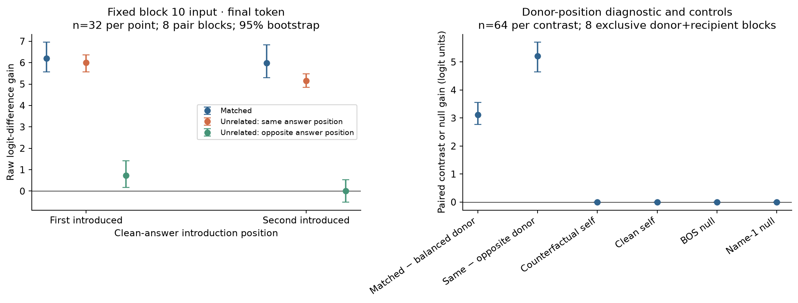

# Inside the Transformer

**Causal Tracing of Language Model Decisions** — an AI-assisted GPT-2-small IOI replication and a position-counterbalanced robustness check. Local inference only; no training, paid API or claim of a newly discovered circuit.

The project asks whether clean residual states restore a paired counterfactual answer preference, and whether a development-selected intervention transfers to new names, templates and answer positions. It is a small methodological study relevant to the causal validation of interpretability explanations, not a model-safety assurance result.

## Main finding

At the frozen **input to zero-based block 10, final token**, matched patches increased clean-answer logit differences in both introduction positions. Unrelated donors worked substantially better when their answer occupied the same introduction position. This is consistent with position/role-sensitive transfer; it does not isolate name identity or a complete computation.

**Baseline first:** on the 64 new evaluation pairs, clean and counterfactual pairwise accuracy was 96.875%, but full-vocabulary top-1 was only 65.625%. All 22 wrong clean top-1 predictions were ` the`. These failures were retained. A near-100% average logit-gap recovery is not near-100% generation accuracy.

| Extension donor | Mean LD gain [95% block-bootstrap interval] | Clean-name pairwise preference after patch | Clean-name full-vocabulary top-1 after patch |
|---|---:|---:|---:|
| Matched | 6.091 [5.441, 6.886] | 90.625% | 62.500% |
| Unrelated, same answer position | 5.575 [5.260, 5.866] | 90.625% | 25.000% |
| Unrelated, opposite answer position | 0.368 [−0.103, 0.965] | 4.688% | 0.000% |

Same-minus-opposite unrelated donor gain was **5.207 [4.641, 5.704]** using a paired contrast. Matched-minus-position-balanced unrelated gain was **3.120 [2.771, 3.554]**. The latter averages two donor conditions; it is not a name-identity isolation test. The matched-minus-same-position contrast was much smaller: **0.516 [0.0012, 1.197]**, with a fragile lower endpoint near zero. No p-values or population-level significance claims are made.

The extension has 64 directed evaluation pairs, 64 disjoint donor pairs, two templates and eight recipient+exclusive-donor blocks. Identity, giver/recipient assignment and introduction order are crossed; the answer remains the recipient in an active-voice continuation. Reverse-direction pairs reuse sentences. Bootstrap intervals resample whole blocks (5,000 draws), not independent prompt rows. Six matched patches failed to restore positive clean-answer LD. Four no-op/structural-null conditions had exactly zero gain.



## What was replicated and extended

The original run contains 128 paired examples across four templates, 256 unmodified prompt evaluations and 12,288 interventions. Development data selected block 10; the original both-held-out cell had mean gain **7.993 [7.334, 8.649]**, but clean answers were always first and unrelated donors recovered 88.3% of the gap. The extension tests that limitation without changing the selected site, using 32 identities absent from the original dataset and 448 interventions per run. Neither dataset is certified absent from GPT-2 pretraining.

IOI, activation patching and token/position analyses are established prior work. In particular, [Wang et al., Appendix A](https://arxiv.org/html/2211.00593v1) already studies token and positional signals at specific heads. Our broad residual-state comparison is a conceptual replication and local robustness evaluation, not invention of those ideas. See the [research report](docs/research-report.md), [detailed extension results](docs/position-counterbalanced-results.md) and [reference audit](audit/literature-audit.md).

## Reproduce

From the repository root, using Python 3.11:

```sh
python3.11 -m venv .venv
.venv/bin/python -m pip install -r requirements-lock.txt
.venv/bin/python -m pip install -e . --no-deps
.venv/bin/python scripts/cache_model.py
sh scripts/reproduce.sh
sh scripts/reproduce_counterbalanced.sh
```

Model setup downloads the pinned public weights/tokenizer once; the extension subsequently runs offline. Commands refuse existing destinations and write new ignored reproduction folders. The full setup is an instruction, not a claim of a fresh-machine installation test. See [reproduction details and tested scope](docs/reproduction.md).

The measured environment is macOS arm64, Python 3.11.17, PyTorch 2.15.0, TransformerLens 2.16.1 and float32. Model and tokenizer revision: `607a30d783dfa663caf39e06633721c8d4cfcd7e`. MPS was checked against CPU with a representative hooked forward; unsupported or discrepant execution falls back to CPU. The frozen package listing is environment-specific, not a portability guarantee.

An independent audit recomputes **2,551 numeric fields** from the bundled raw CSV files, including paired contrasts and confidence intervals. Run it without new inference:

```sh
.venv/bin/python scripts/audit_results.py
.venv/bin/python -m pytest -q
```

Original and extension same-machine repeats matched the compared measurements exactly. Release-candidate execution, current tests, exclusions and remaining decisions are recorded in [the publication audit](audit/research-integrity-audit.md); older verification JSON files describe their historical run, not a new fresh-machine validation.

## Evidence and limitations

- [Raw original results](results/interventions.csv), [raw extension results](results/counterbalanced-v1/interventions.csv), [baseline failures](results/counterbalanced-v1/baseline_failures.csv), [failure analysis](results/counterbalanced-v1/failure_analysis.json), and [numeric audit ledger](audit/numeric-audit.csv).
- [Original protocol](docs/protocol.md), [extension protocol](docs/position-counterbalanced-protocol.md), [learning notes](docs/learning-notes.md), [application wording](docs/application-summary.md), and [file inventory](FILES.md).
- Only eight constructed blocks and two fixed extension templates; intervals are conditional sensitivity estimates, not guaranteed population coverage. Whole late residual vectors cannot establish necessity, unique features or complete circuits. Donor position and relative giver/recipient role remain coupled. Full-vocabulary baseline failures limit restoration claims. No external preregistration, fresh-machine installation or cross-hardware replication is asserted.

## Attribution and release status

AI assistance was extensive: design, coding, literature review, execution, analysis, writing and this audit. The student supplied goals and scope; this repository does not claim independent student implementation. See the [contribution statement](docs/ai-assistance.md).

Original project software and associated documentation are licensed under the [MIT License](LICENSE), copyright **2026 Hajar Mrifag**. This project uses **TransformerLens 2.16.1 (TransformerLensOrg)**, PyTorch and Hugging Face libraries; their licenses and GPT-2's upstream notice remain separate and are recorded in [third-party notices](THIRD_PARTY_NOTICES.md). The original IOI paper and its token/position analysis are credited above and in the report. No model weights, vendored library packages, paper figures or external benchmark dataset are bundled. No separate data/content license is added by this code-license decision.

The owner has authorized a local initial commit. Creating a public remote, publishing, pushing and application submission still require explicit approval; none has occurred. Suggested GitHub metadata and repository layout remain in [publication notes](docs/publication.md). The prior audit records describe the earlier unlicensed review candidate; the [licensing/publication preparation record](audit/publication-readiness.json) describes this step.
