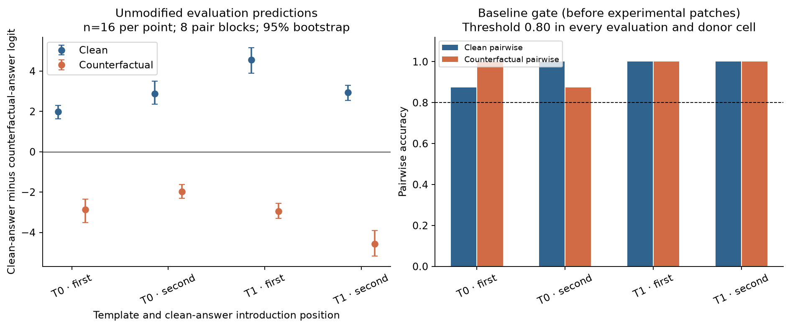
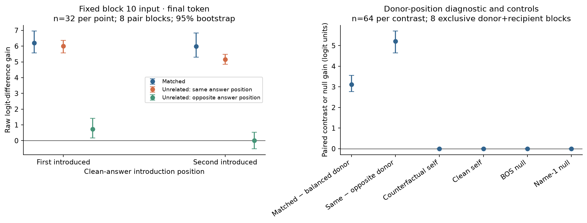

# Position-counterbalanced IOI robustness: executed extension v1

This extension addresses the original study's confounding of clean answer with first-name position. It was designed after observing the earlier study and is prospectively held out from its development data and layer selection. The prior result files are unchanged; original prose is archived in `docs/history/position-counterbalanced-v1/`.

## Relation to prior work

Wang et al. already examine token and positional signals in [Appendix A of the original IOI paper](https://arxiv.org/html/2211.00593v1). This residual-vector donor comparison is a local robustness exercise, not discovery of position signals or reproduction of their head-level identification. Current setup and publication-audit scope are described in [reproduction.md](reproduction.md) and [the integrity audit](../audit/research-integrity-audit.md). The test counts below record the extension-stage verification; the final audit adds separate checks.

## Fixed question and design

The intervention remained **`blocks.10.hook_resid_pre`, final token**, taken from the original development-selected site. There was no layer sweep or selection on these new results. [The protocol](position-counterbalanced-protocol.md) was fixed before any new predictions; its hash and the frozen original summary/hash are saved with the results.

Eight evaluation name pairs and eight disjoint, exclusively paired donor name pairs use 32 identities absent from the original data. Two new templates (station/ticket and library/book) cross both introduction orders and both giver identities: 64 evaluation and 64 donor directed clean/counterfactual pairs. Every identity is recipient and giver equally often and is the clean answer once at each introduction position per template. The clean correct answer is first on 32 evaluation rows and second on 32. The counterpart changes only the repeated giver name. All 128 candidates passed tokenization; zero exclusions and no performance filtering.

Both corruption directions are included: complementary rows exchange their clean/counterfactual texts. There are 64 distinct evaluation sentences and 64 distinct donor sentences, not 256 independent sentences. The eight complete recipient+exclusive-donor blocks, not individual rows, are the resampling units.

“Role counterbalancing” concerns which identity occupies giver and recipient roles. The task still asks for the recipient in an active-voice `... to` continuation. It does not test a recipient answer versus a giver answer to the same question, or counterbalance all syntactic roles. Both templates are grammatical English; tokenization checks establish alignment, not human linguistic judgment.

## Baseline verification before recovery interpretation

All unmodified clean/counterfactual evaluation and donor baselines were saved and checked before experimental patching. A stratum passed if both name-pair accuracies were ≥80% and its mean LD gap exceeded 0.5. All eight pool × template × answer-position strata passed. This deliberately gates the two-name LD metric, not full-vocabulary generation quality.

| Pool | Template | Clean answer position | Clean / counterfactual pairwise accuracy | Clean / counterfactual full-vocabulary top-1 | Mean LD gap | Gate |
|---|---|---:|---:|---:|---:|---|
| donor | T0 | 1 | 100.00% / 100.00% | 25.00% / 25.00% | 4.831 | pass |
| donor | T0 | 2 | 100.00% / 100.00% | 25.00% / 25.00% | 4.831 | pass |
| donor | T1 | 1 | 100.00% / 100.00% | 100.00% / 100.00% | 8.212 | pass |
| donor | T1 | 2 | 100.00% / 100.00% | 100.00% / 100.00% | 8.212 | pass |
| evaluation | T0 | 1 | 87.50% / 100.00% | 18.75% / 43.75% | 4.851 | pass |
| evaluation | T0 | 2 | 100.00% / 87.50% | 43.75% / 18.75% | 4.851 | pass |
| evaluation | T1 | 1 | 100.00% / 100.00% | 100.00% / 100.00% | 7.507 | pass |
| evaluation | T1 | 2 | 100.00% / 100.00% | 100.00% / 100.00% | 7.507 | pass |

Evaluation pairwise accuracy was **96.88%** for clean prompts and **96.88%** for their counterfactuals. Full-vocabulary top-1 was **65.62%** for each. The mean clean/counterfactual LD gap was 6.179. Donor pairwise accuracy was 100%, but donor top-1 was 62.50%. This baseline is materially weaker than the original study's easy prompts.

Two distinct evaluation clean sentences preferred the wrong candidate name; complementary rows reproduce those as counterfactual failures:

- `evaluation-b4-t0-o1-g0`: clean answer Catherine, LD -0.304; top-1 `the`.
- `evaluation-b6-t0-o0-g1`: clean answer Patrick, LD -0.525; top-1 `the`.

Every one of the 22 incorrect evaluation clean top-1 predictions and 24 incorrect donor clean top-1 predictions was the token ` the`, all on the station/ticket template. Thus the model often chose an open-ended noun-phrase continuation rather than either introduced name. The observations do not establish why this occurs. The library/book template had 100% baseline top-1 in both pools. All cases are retained in `baseline_failures.csv`; role reversals mean failure rows are not independent new failures.

## Frozen-site interventions and uncertainty

For each evaluation recipient, patch the matched clean vector, or use its exclusive donor pair with the same or opposite clean-answer introduction position, holding template and introduction order fixed. An unrelated donor contains neither recipient name. Four additional checks transplant clean/counterfactual self states at the final token, clean BOS at BOS and clean first-name state at first-name position. All are at block input 10; the last two are structural nulls before the changed giver token. There are seven interventions per evaluation row, **448 executed interventions per run**. The balanced unrelated comparison is the per-row average of the two unrelated runs, not an additional physical intervention.

Raw gain = patched LD minus the recipient baseline LD. LD always uses that row's clean answer minus its counterfactual answer, including when the clean answer is second. Clean-self gain uses the clean baseline. Recovery is a ratio of aggregate means without clipping; it is not the fraction of prompts correctly generated.

All intervals below use 5,000 percentile bootstrap resamples (seed 20261114) of eight exclusive evaluation+donor blocks, keeping introduction orders, role reversals and templates together. Contrasts are formed within each recipient before resampling. Donor mapping and templates remain fixed. Accuracy percentages are descriptive; no independent-trial binomial intervals are asserted.

| Donor condition | Mean LD gain [95% block-bootstrap interval] | Aggregate gap recovery | Clean-name pairwise preference | Clean-name full-vocabulary top-1 |
|---|---:|---:|---:|---:|
| Matched clean | 6.091 [5.441, 6.886] | 98.57% | 90.62% | 62.50% |
| Unrelated, same answer position | 5.575 [5.260, 5.866] | 90.21% | 90.62% | 25.00% |
| Unrelated, opposite answer position | 0.368 [-0.103, 0.965] | 5.95% | 4.69% | 0.00% |

- Answer introduced first: 6.196 [5.571, 6.952] LD gain, n=32, 8 blocks.
- Answer introduced second: 5.986 [5.300, 6.826] LD gain, n=32, 8 blocks.

The paired matched-minus-position-balanced-unrelated contrast was **3.120 [2.771, 3.554]**. Both answer-position matched-gain lower endpoints and this contrast's lower endpoint exceeded zero, so the predeclared narrow LD restoration criteria were met conditional on the baseline gate and this constructed sample.

The same-minus-opposite unrelated-donor contrast was **5.207 [4.641, 5.704]**. The unrelated same-position condition recovered 90.21% of the gap; the opposite-position condition recovered 5.95%. The balanced unrelated mean was 2.971 [2.654, 3.337]. Matched-minus-same-position advantage was only 0.516 [0.0012, 1.197], with a lower endpoint very close to zero. That comparison is a weak basis for claims about name-specific information.

All four null/control gains were exactly zero. The official helper and custom frozen-site patch agreed exactly. CPU/MPS LD discrepancy at this same site was below 0.02 (see `device_validation.json`); MPS float32 was used.





## Failures and interpretation

Matched patching left **6/64** evaluation rows without a positive clean-answer LD, all on the station/ticket template. Its pairwise clean preference was 90.62% and full-vocabulary clean-answer top-1 was 62.50%. Unrelated same-position patches achieved the same pairwise preference rate, but only 25.00% clean-answer top-1. A near-100% aggregate LD-gap recovery therefore does not imply reliable restoration of generation or even of every two-name decision. Individual failures, original baselines, patched LD and top-1 are saved in `failure_analysis.json` and the raw CSV files.

The fixed site transfers a positive LD effect to both answer positions. The large dependence on donor answer position is consistent with transferable relative-position/role information rather than a need for the donor to contain the recipient names. Flipping donor answer position also flips which introduced identity is giver, so this experiment cannot disentangle position from relative giver/recipient role internally. It does not identify the represented variable, establish necessity, or recover a complete IOI circuit. The balanced-donor advantage partly reflects averaging a useful and a largely unhelpful donor condition; it is not a name-identity isolation test.

The original 88.3% unrelated-donor result used same-position donors because every clean answer was first. The new same-position result is qualitatively consistent, but the datasets and baselines differ. Comparing the original number directly with the new balanced average as a controlled before/after estimate would be invalid.

## Limitations

- Eight manually constructed evaluation+donor blocks and only two fixed templates. Intervals are conditional sensitivity estimates with limited calibration; they do not establish population coverage, donor-selection uncertainty, or broad language generalization.
- The new names and exact sentences are held out from the original experiment, not certified absent from GPT-2 pretraining. This study was motivated by the earlier observed confound.
- Identity, giver/recipient assignment and introduction order are crossed; active voice, the recipient answer slot and other grammatical properties remain fixed. No gender/demographic balancing or human ambiguity study was performed.
- The station/ticket template has substantial full-vocabulary baseline failure. Restoration claims apply to the predeclared two-name LD metric, with failures retained, not to reliable open-ended generation.
- Whole late residual vectors contain accumulated computations. Unrelated donor position and role vary together, and the exclusive donor mapping is fixed. No full circuit, unique feature, necessity or model-safety claim follows.
- Reverse-direction rows and repeated templates are dependent. Block resampling respects this fixed design but eight blocks remain a small empirical base. Position and template comparisons are not equivalence tests.
- Same-machine numerical repeatability was checked. A fresh environment, another machine, alternative models, passive voice and other intervention sites were not evaluated.

## Reproduction and quality

With the existing project environment and cached GPT-2 revision:

```sh
sh scripts/reproduce_counterbalanced.sh
```

Default output is a fresh `results/counterbalanced-reproduced/`; existing output folders are refused. Use a new destination argument for each repeat. Original `scripts/reproduce.sh` and original results remain available. The extension runner reads the frozen prior site, performs baseline verification, patches only that site (plus the declared same-layer null positions), analyzes, plots and runs tests. It never tunes the site. Baseline failures are retained automatically; if the gate fails on a reproduction, pooled recovery is suppressed.

Two complete extension runs matched all compared raw numerical measurements exactly. The main run took 3.98s excluding Python startup; plots and tests are additional. **22 tests passed, zero failed or skipped**, including the original 14 and eight extension tests. All 44 pre-existing result files were verified byte-identical against the pre-extension hash inventory. The original README, research report and file inventory were archived before editing. No scientific examples were discarded and no software failures occurred in the new executed runs; the unmodified model and some patches did fail as detailed above. The harmless upstream `torch_dtype` deprecation warning remains. Nothing was committed, published or pushed.

This extension's implementation, execution and drafting were AI-assisted under the same contribution disclosure as the original report. It extends the local robustness evaluation, not the invention of IOI or activation patching.
