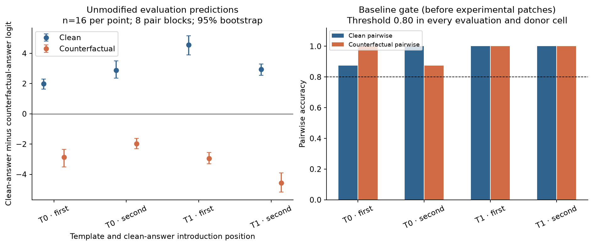
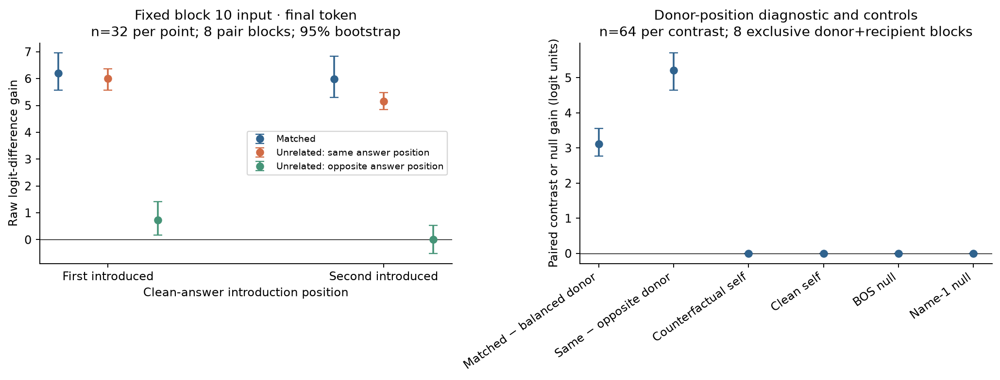

# Inside the Transformer: Causal Tracing of Language Model Decisions

## Abstract

This AI-assisted conceptual replication uses GPT-2-small to test whether clean residual states restore a clean-answer preference after a grammatical IOI counterfactual. An original 128-pair study selected final-token input to block 10 on development data. A subsequent position-counterbalanced test kept that site fixed on 64 new evaluation pairs and 64 disjoint donor pairs. Matched patches increased logit differences in both answer positions. Overall matched gain was 6.091 [5.441, 6.886]; unrelated same-position and opposite-position donor gains were 5.575 [5.260, 5.866] and 0.368 [−0.103, 0.965]. Intervals are conditional name-pair-block bootstrap summaries, not population significance claims. Baseline pairwise accuracy was 96.875%, but full-vocabulary top-1 was only 65.625%; six matched patches failed the clean-name preference. The study demonstrates a reproducible conditional intervention effect and donor-position sensitivity, without isolating name identity, necessity or a complete circuit.

## Background, attribution and contribution

[Wang et al. (2022 preprint; ICLR 2023)](https://arxiv.org/abs/2211.00593) established IOI as a natural-language GPT-2-small behavior and investigated an attention-head circuit using causal interventions. Their v1 describes 26 heads in seven classes and evaluates faithfulness, completeness and minimality. This project does not reproduce that full circuit, exact dataset, head taxonomy or validation program.

The original paper's [Appendix A](https://arxiv.org/html/2211.00593v1) already investigates token and positional signals using altered names and positions at S-Inhibition heads. Our whole-residual comparison is a local robustness exercise, not discovery of positional information. [Meng et al. (NeurIPS 2022)](https://arxiv.org/abs/2202.05262) provide a causal-tracing precedent and ROME weight editing; no weight editing is performed here. [Zhang and Nanda (ICLR 2024)](https://arxiv.org/abs/2309.16042) show that metric and corruption choices affect patching conclusions. No single cited work is credited with uniquely originating all causal activation interventions.

The contribution is implementation and evaluation: tokenizer-validated pairs, explicit failure retention, per-example interventions, a development-only selection rule, a fixed-site counterbalanced donor diagnostic, and an auditable local reproduction package. The AI safety connection is practice in causally validating explanations and checking their limits. This does not provide deployment safety, honesty or deception-detection evidence.

## Question and protocols

Can a clean internal state move a counterfactual prompt's next-token preference toward its paired clean answer, and does a development-selected site transfer across names, templates and answer positions?

The [original protocol](protocol.md) specifies a layer-selection rule on development examples only. The [extension protocol](position-counterbalanced-protocol.md) fixes `blocks.10.hook_resid_pre` at the final token before the new evaluation, with no new layer search. It was designed after the original positional confound was observed; the new examples are held out from the original site selection, not a new independent hypothesis-development process. These are locally recorded protocols, not externally preregistered studies. Content hashes support preservation but are not independent proof of chronology or execution.

The extension's predeclared criteria require: usable baseline strata; positive matched-gain interval lower endpoints in both clean-answer introduction positions; and a positive lower endpoint for the paired matched-minus-position-balanced unrelated contrast. These conditional criteria were met. They are not a calibrated population-level significance test with eight fixed blocks.

## Methods

Clean prompts introduce two people and repeat one as giver. The intended next name is the other person. The corrupted prompt changes only that repeated giver name, reversing the intended recipient. Both sentences are grammatical. “Corrupted” names the experimental direction, not an invalid sentence or a model failure when it follows the changed meaning.

Every example uses explicit BOS, single leading-space answer tokens, checked answer-continuation boundaries, equal clean/corrupted lengths, exactly one changed token, verified name occurrences and aligned semantic positions. Tokenization/alignment exclusions are logged; behavioral failures are never excluded. Both executed datasets had zero exclusions.

The metric holds the clean answer A and counterfactual answer B fixed within a row:

- LD = logit(A) − logit(B).
- Gain = LD(patched) − LD(counterfactual), except clean-self controls use their clean baseline.
- Secondary recovery = mean gain / mean(clean LD − counterfactual LD), not a mean of individual ratios. It is unclipped and suppressed when the applicable baseline gate fails. No interval is reported for this ratio.

A positive clean LD and a negative corrupted LD both indicate correct two-name preference. Full-vocabulary top-1 is reported separately. A vector replacement changes one entire 768-dimensional residual state; zero-based layer 10 is the input to block 10 after blocks 0–9, not its output. All weights remain fixed.

The pinned model and tokenizer revision is `607a30d783dfa663caf39e06633721c8d4cfcd7e`; TransformerLens 2.16.1 uses its standard layer-norm folding and weight-centering defaults. Float32 runs cache only required residual sites. Custom hooks agree with the official generic patch helper at representative validation sites. MPS/CPU LD differences were 0.00001335 in the original check and 0.00002384 in the extension check; actual null controls additionally validate the executed path. These spot checks do not certify every possible MPS operation.

## Original study: 128 pairs

Two disjoint 16-name pools form eight unordered pairs per pool. Four fixed templates and both name orders yield 128 paired examples, 32 in each names × templates evaluation cell. Across the entire study there are 16 distinct name pairs, reused across templates; the cells are not independent studies. This run records 256 unmodified prompt evaluations and 12,288 interventions (12 layers × five patch positions plus three control conditions per pair).

The layer with largest mean final-token gain among layers 6–11 on development names and templates was selected: layer 10. The full sweep was collected before automated aggregation; the selection function uses only development rows. Held-out sweeps are descriptive and never feed selection.

| Cell | Pairs / name-pair clusters | Clean LD | Counterfactual LD | Matched gain [95% interval] | Gap recovery |
|---|---:|---:|---:|---:|---:|
| Development | 32 / 8 | 4.141 | −4.325 | 8.627 [7.423, 9.762] | 101.90% |
| New names | 32 / 8 | 4.305 | −5.012 | 9.636 [8.947, 10.316] | 103.42% |
| New templates | 32 / 8 | 4.031 | −3.256 | 7.091 [6.170, 7.966] | 97.30% |
| Both held out | 32 / 8 | 4.371 | −3.601 | 7.993 [7.334, 8.649] | 100.27% |

Unmodified pairwise and full-vocabulary top-1 accuracy was 100% on these original clean and counterfactual prompts. Patched full-vocabulary top-1 was not retained in this study, so no patched top-1 claim is made. Both-held-out matched-minus-unrelated gain was 0.950 [0.590, 1.292], computed as a paired contrast. Unrelated donors recovered 88.3% of the aggregate gap. Clean answers were always the first introduced name, and the cyclic donor assignment shared pairs across recipient comparisons; these are important design limitations.

Self-patches and pre-change-position patches had zero gain. Restoring the only changed embedding at layer 0 reproduced clean LD exactly; this is a positive implementation check by construction, not a discovered downstream mechanism.

## Position-counterbalanced extension

Eight new evaluation pairs and eight disjoint donor pairs cross two templates, both introduction orders and both giver identities. This yields 64 directed evaluation pairs and 64 donor pairs. The 32 identities do not occur in the original dataset. Each identity serves as giver and recipient equally often; the clean answer is first on 32 evaluation rows and second on 32. The task still asks for the recipient in an active-voice continuation. Counterbalancing identity/role assignment does not counterbalance every syntactic role.

Complementary rows swap clean and corrupted texts. There are 64 distinct evaluation sentences and 64 donor sentences, not 256 independent sentences. Each evaluation name pair has an exclusive donor-name pair, with no donor sharing across the eight blocks. Donors use the same template and introduction order, with clean-answer position either matched or reversed. Their per-row mean is the position-balanced unrelated comparison; it is an average of output effects from two runs, not a separately executed average-vector intervention.

### Baseline verification

Before experimental patching, every pool × template × answer-position cell had to have clean and corrupted pairwise accuracy at least 80% and mean clean/corrupted LD gap above 0.5. All eight cells passed. This threshold applies to the two-name LD metric, not open-ended generation.

Evaluation clean and corrupted pairwise accuracy was 62/64 = 96.875% each. Full-vocabulary top-1 was 42/64 = 65.625% each. Donor pairwise accuracy was 100%, but donor top-1 was 40/64 = 62.5%. All 22 evaluation and 24 donor wrong clean top-1 predictions were ` the`, on the station/ticket template. The library/book template had 100% baseline top-1 in both pools. Two distinct evaluation clean sentences preferred the wrong candidate name; reverse-direction rows reproduce those as corrupted failures. No failed examples were removed. These facts materially limit a restoration interpretation.

### Fixed-site effects

| Donor | Gain [95% block-bootstrap interval] | Gap recovery | Clean pairwise preference after patch | Clean-answer full-vocabulary top-1 after patch |
|---|---:|---:|---:|---:|
| Matched | 6.091 [5.441, 6.886] | 98.57% | 58/64 = 90.625% | 40/64 = 62.5% |
| Unrelated, same answer position | 5.575 [5.260, 5.866] | 90.21% | 58/64 = 90.625% | 16/64 = 25% |
| Unrelated, opposite answer position | 0.368 [−0.103, 0.965] | 5.95% | 3/64 = 4.688% | 0/64 = 0% |

Matched gains by answer position were 6.196 [5.571, 6.952] for first and 5.986 [5.300, 6.826] for second (n=32 each; eight blocks). Positivity in both positions is not an equivalence claim.

Paired contrasts, formed per recipient before block resampling:

- Same-position minus opposite-position unrelated donor: **5.207 [4.641, 5.704]**.
- Matched minus position-balanced unrelated donor: **3.120 [2.771, 3.554]**.
- Matched minus same-position unrelated donor: **0.516 [0.0012, 1.197]**.

The last lower endpoint is close to zero and fragile with eight fixed blocks. It is not strong evidence of an isolated name-specific feature. The balanced-donor advantage partly reflects averaging a useful and an unhelpful donor condition. Separate condition error bars are not used to establish a paired contrast.

Four controls — corrupted self, clean self, BOS and first-name pre-change state — had zero gain at the fixed layer. There were 448 interventions per run. Six matched patches failed to restore positive clean-answer LD, all on the station/ticket template. Near-complete average LD-gap recovery therefore does not mean reliable recovery of every decision or generated token.

See [the detailed extension record](position-counterbalanced-results.md) for the full baseline-stratum table and individual failures. The original five figures are retained in `results/figures/`; their numerical aggregates are audited.

## Uncertainty, interpretation and limits

Original summaries use seed 20261113; extension summaries use 20261114. Both use 5,000 percentile bootstrap draws of equal-size name-pair/block means. All orders and repeated templates remain within their cluster. Extension contrasts preserve the exclusive recipient+donor pairing. The original donor mapping has additional cross-pair dependence; its intervals condition on that assignment. No independent-row bootstrap, p-value, template population inference or multiplicity-adjusted simultaneous confidence claim is made. Layer-sweep intervals are descriptive and pointwise. With eight constructed blocks per cell, even nominal 95% intervals have uncertain population coverage.

The donor-position effect is consistent with transfer of relative-position/role information. Changing donor answer position also changes relative giver/recipient assignment, so these mechanisms are not separated. Entire late residual states may already encode accumulated answer-relevant computation. These experiments establish sensitivity to specified replacements in hybrid clean/counterfactual contexts; they do not establish necessity, uniqueness, a complete head circuit, or the identity of a represented variable.

Other limits: two fixed extension templates, manually selected names without demographic balancing, fixed donor assignment, no training-data contamination audit, no passive-voice study, no second model, no path-patching or circuit-faithfulness analysis, and weak open-vocabulary baseline behavior in one template. New examples are held out from this experiment, not certified unseen by the pretrained model. Same-machine numerical repetition is not fresh-machine or cross-hardware replication.

## Reproducibility, audit and attribution

Raw baselines, interventions, exclusions, failures, aggregates, figures, configuration, model revision, runtime metadata and recorded source hashes are retained. Historical verification JSON files are run records, not independent certificates. The independent [numeric audit](../scripts/audit_results.py) recalculates 2,551 reported fields from CSVs without using the analysis implementations; its [ledger](../audit/numeric-audit.csv) makes values traceable. Inference repeats and hook tests separately support executable provenance. Exact matches of compared measurements do not imply every metadata file is byte-identical.

See [reproduction instructions](reproduction.md), [publication audit](../audit/research-integrity-audit.md), [literature audit](../audit/literature-audit.md), and [AI contribution statement](ai-assistance.md). Setup has not been validated on a fresh machine or empty model cache. The package lock is the executed environment, not a general portability guarantee.

The student supplied project goals and scope. AI assistance covered design, implementation, references, execution, analysis, writing and audit; no independent student implementation or technical mastery is inferred. No global novelty claim is made. Before application use, personal contribution statements should reflect only the student's actual subsequent work.
